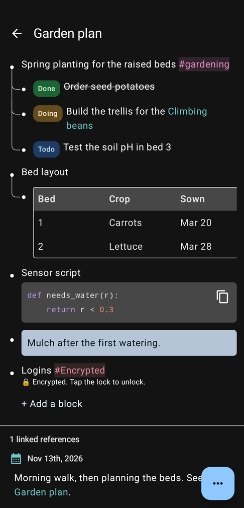
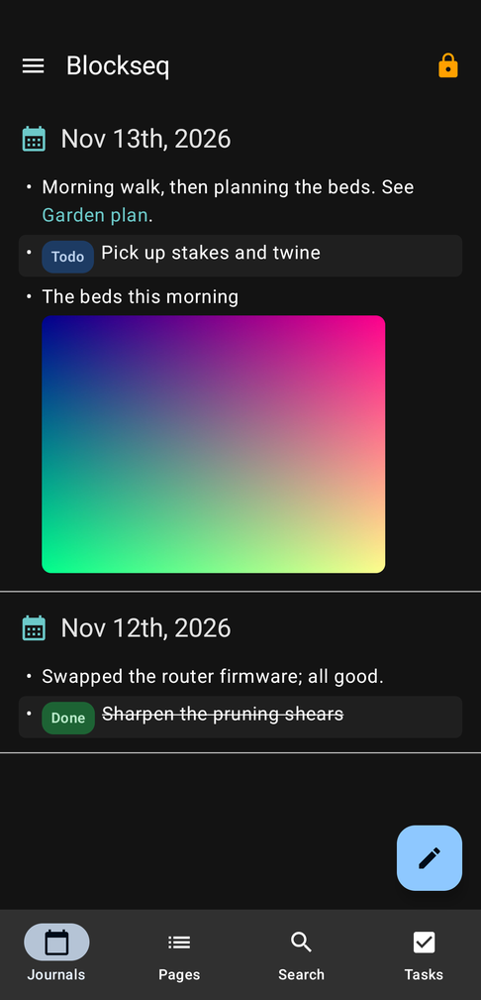
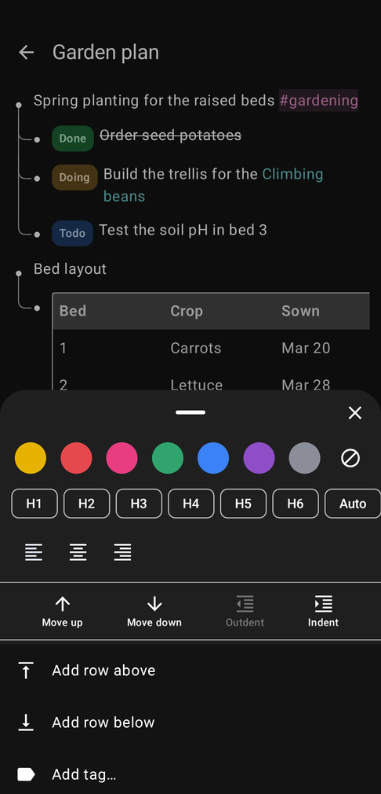
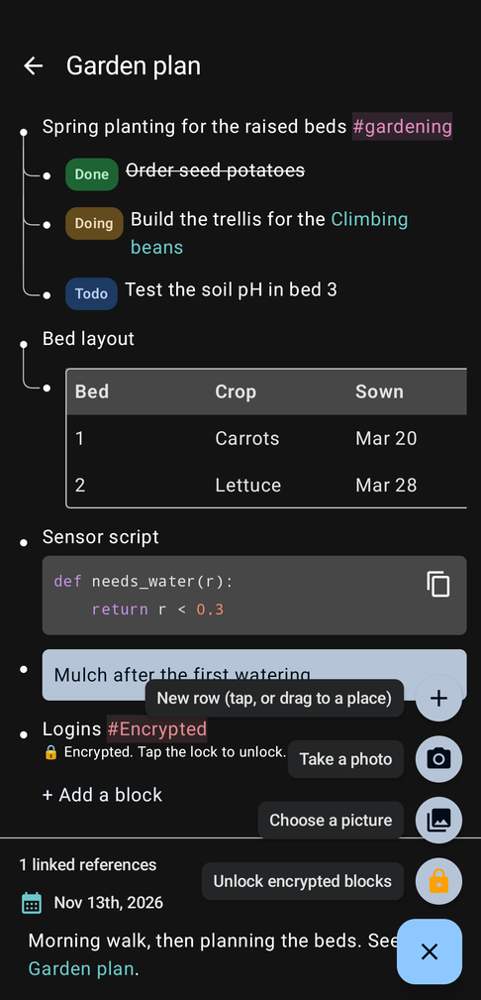
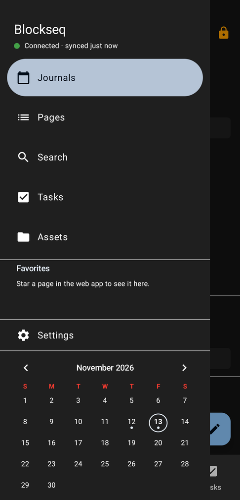
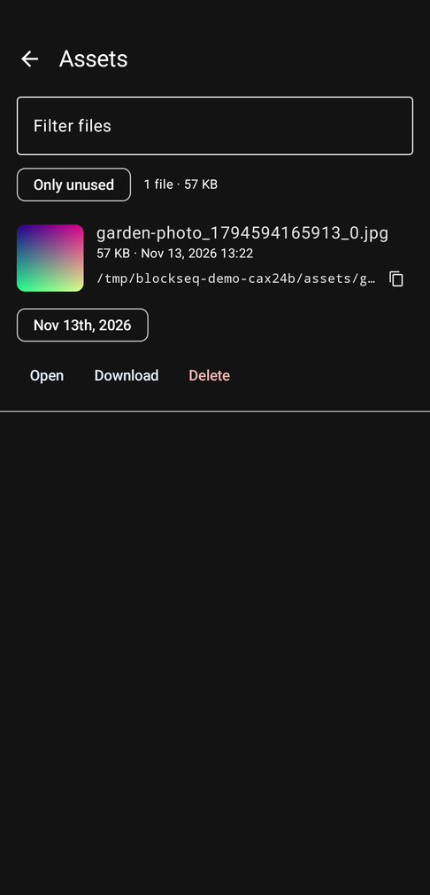

# Blockseq for Android

[](LICENSE)
[](https://kotlinlang.org)
[](https://developer.android.com/compose)
[](#install)
[](https://github.com/crome1394/blockseq)
[](ARCHITECTURE.md#privacy)

A native Android app for [Blockseq](https://github.com/crome1394/blockseq),
the self-hosted, Logseq-style outliner. Read and edit your notes on your
phone, straight from your own server.

<p align="center"></p>

## Features

| | |
|---|---|
| **Read** | Journals, pages, links, tags, task badges, tables, code and tips; lines join parents and children |
| **Edit** | Tap a block to edit; Enter splits it; a toolbar to indent, move, strike through, add a rule or a picture |
| **Move and add rows** | Press, hold and drag a block (sideways changes its depth); drop it on the bin to delete, with Undo; tap the strip above a block to add a row there |
| **Block menu** | Press and hold: colour, heading, alignment, move, add row above/below, tag, strikethrough, timestamp, copy, share, cut, delete |
| **Page ⋯ menu** | New row (tap, or drag to a place), take a photo, choose a picture, lock or unlock |
| **Pictures** | Thumbnails; full screen with zoom, share, save, remove or delete; stays open when the phone turns |
| **Assets** | Every uploaded file, as in the web app: where it is used, filter, only unused, open, download, delete |
| **Left pane** | Sections, Assets, favorites, workbooks, Settings and a month calendar (first day of the week is a setting) |
| **Quick capture** | A pencil on Journals for a quick note; a + on Tasks with status and due date; a filter card on Pages |
| **Tasks** | Every open task in one list; tap a badge to step its status |
| **Search** | Full-text search, with the field at the top or bottom |
| **Encrypted blocks** | `#Encrypted` blocks unlock with your password and decrypt on the phone, byte-compatible with the web app |
| **Safe saves** | The server's version check; a conflict offers *Keep mine*, *Use theirs*, or *See the differences* (changed words marked) |
| **Live** | Pages reload when another device saves them |
| **Tailscale when needed** | Away from home (mobile data or another Wi-Fi), connects Tailscale while the app is open, and disconnects after |
| **Paired, not logged in** | The password is used once; the phone gets its own token, revocable on the server |
| **Scratchpad widget** | Your Scratchpad page on the home screen, grouped by day, with a + to add notes; works offline |

## Screenshots

| Journals | Block menu | Page ⋯ menu |
|---|---|---|
|  |  |  |
| **Left pane** | **Assets** | **Page** |
|  |  |  |

All screenshots use the made-up notes from `tools/demo-server.sh`.

## Install

1. Run a [Blockseq server](https://github.com/crome1394/blockseq) (0.1.0 or later with device pairing) behind HTTPS, with `BLOCKSEQ_PASSWORD` set.
2. Build and install the app (see [Building](#building)), or install a release APK.
3. Open it, enter your server address and password, and tap **Pair**.

The phone must reach the server, e.g. on your network or over a VPN such as Tailscale. With Tailscale installed and logged in, the app connects it by itself when the server is out of reach ([how](ARCHITECTURE.md#tailscale)). Only the Scratchpad widget works offline.

## Building

```sh
./gradlew assembleDebug                 # app/build/outputs/apk/debug/app-debug.apk
adb install -r app/build/outputs/apk/debug/app-debug.apk
./gradlew testDebugUnitTest             # unit tests (outline format, tasks, encryption)
tools/install-release.sh                # minified build (~3 MB), signed with your debug key, installed
```

Needs JDK 21 and the Android SDK (platform 36). The Gradle wrapper downloads Gradle itself.

## Documentation

| Guide | What's in it |
|---|---|
| [Architecture](ARCHITECTURE.md) | How the app is built, pairing, saving, encryption, privacy |
| [Changelog](CHANGELOG.md) | What changed, by release |
| [Contributing](AGENTS.md) | How to build, test on a phone, and the rules for changes |

## License

[MIT](LICENSE). A clean-room implementation, like the server: no code from Logseq.
